# radio-bulletin-ie

Information extraction over **historical Dutch ANP radio bulletins from 1939**: named entity recognition (NER) with an LLM and relation extraction (RE) with JEV AI.

This repository covers the **two upstream stages** of a larger historical-knowledge-graph effort:

1. **NER** — `src/NER/` — LLM-based entity and topic annotation with strict structured outputs.
2. **RE** — `src/RelationE/` — candidate-pair generation and JEV-based relation classification.

The downstream **knowledge-graph construction** (NetworkX + RDF/SPARQL) is intentionally kept in a separate companion repository (`radio-bulletin-kg`). The contract between them is the JSONL produced here: one record per bulletin, carrying entities (NER) and relations (RE).

---

## Pipeline at a glance

```mermaid
flowchart LR
    A["ANP bulletins<br/>(KB dataset, 1939 subset)<br/>JSONL: bulletin_id, text"] --> N["NER<br/>src/NER<br/>LLM + Structured Outputs"]
    N --> E["entity_annotations_raw.jsonl<br/>entities, topics, offsets"]
    E --> C["candidate pairs<br/>src/RelationE/core/generator"]
    C --> J["JEV batches<br/>src/RelationE/core/jev"]
    J --> D["decision + merge<br/>src/RelationE/core/decision"]
    D --> R["relations.jsonl<br/>relations, probabilities, model"]
    R --> RF["refine (optional)<br/>src/RelationE/refine"]
    RF --> RR["relations_refined.jsonl"]
    RR --> EX["export<br/>src/RelationE/export"]
    EX --> NR["ner_re.jsonl + Label Studio tasks"]
    RR --> KG["radio-bulletin-kg<br/>(separate repo)"]
```



The NER output is the RE input. The RE output is the KG input. Each stage is resumable (per-bulletin caching, append-only JSONL).

---

## Data source

The source material is the **[Delpher ANP radio bulletins digital](https://www.kb.nl/en/research-find/datasets/delpher-anp-radiobulletins-digital)** dataset, published by the **KB, National Library of the Netherlands (Koninklijke Bibliotheek)** and browsable via [Delpher radiobulletins](https://www.delpher.nl/nl/radiobulletins).

- **Content:** ~1,474,000 digitized typescripts (typoscripts) of ANP radio news broadcasts.
- **Period:** 1937–1984. **This project works on the 1939 subset.**
- **Language:** Dutch (1939 spelling; OCR errors and old orthography expected).
- **Access:** free via Delpher.

> **License:** check the KB dataset page above for the current terms before redistributing any source text or derived data. This repository does not redistribute KB source data; users are expected to obtain bulletins from Delpher themselves.

**Suggested citation for the dataset:**

> KB, National Library of the Netherlands. *Delpher ANP radio bulletins digital.* Dataset, 1937–1984. https://www.kb.nl/en/research-find/datasets/delpher-anp-radiobulletins-digital

---

## Repository structure

```
radio-bulletin-ie/
├── data/                          # input & output JSONL (not committed; see .gitignore)
│   ├── entity_annotations_raw.jsonl   # NER output  =  RE input
│   ├── relations.jsonl                # RE first pass
│   ├── relations_refined.jsonl        # RE after refine
│   ├── ner_re.jsonl                   # combined NER+RE (export)
│   ├── label_studio_tasks.json        # Label Studio pre-annotation tasks
│   ├── label_studio_config.xml        # Label Studio labeling interface
│   └── annotation_issues.jsonl        # per-bulletin issue log
├── src/
│   ├── NER/                       # Stage 1 — LLM named entity recognition
│   │   ├── run.py                 # entry point: chunk → call → correct → validate
│   │   ├── prompts.py             # ENTITY_SYSTEM_PROMPT (+ an LLM RE prototype prompt)
│   │   ├── validate.py            # per-type Pydantic re-validation + offset checks
│   │   └── models/
│   │       ├── base.py            # MentionBase (id, text, offsets, confidence)
│   │       ├── entities.py        # active entity Pydantic schemas (6 types)
│   │       ├── entities_long_desc.py   # extended variant with Dutch examples
│   │       └── bulletins.py       # NERExtraction / NEROutput, topic literals
│   ├── RelationE/                 # Stage 2 — JEV relation extraction
│   │   ├── cli.py                 # plan / extract / schema-check commands
│   │   ├── pipeline.py            # end-to-end orchestration per bulletin
│   │   ├── refine.py              # second pass: re-run low-relation bulletins (undecided pairs only)
│   │   ├── export.py              # combine NER+RE → ner_re.jsonl + Label Studio tasks
│   │   ├── core/
│   │   │   ├── generator.py       # candidate pair generation + context grouping
│   │   │   ├── jev.py             # marked contexts, option builder, JEV batches & calls
│   │   │   ├── decision.py        # probability → relation decision + dedup merge
│   │   │   └── sentences.py       # sentence segmentation, distances, context spans
│   │   └── dataLayer/
│   │       ├── schema.py          # 3-level relation schema (fine/coarse/category)
│   │       ├── models.py          # dataclasses (Mention, Bulletin, CandidatePair, …)
│   │       └── io.py              # read/clean NER output for RE
│   ├── configs/
│   │   ├── ner_cfg.py             # ApiConfig(client, model)
│   │   └── re_cfg.py              # PipelineConfig, CandidateConfig, DecisionConfig
│   └── util/
│       ├── io.py                  # read_jsonl, append_jsonl, load_records_by_id, log_issue
│       ├── correct_llm.py         # correct_llm_offsets — repair LLM offset mistakes
│       ├── splitters.py           # chunk_text
│       └── names.py               # is_same_entity, mention_key
└── README.md
```

---

## NER schema

Six entity types, each with optional subtypes. Every entity carries zero-based, end-exclusive character offsets (`text[start:end] == text` is enforced) and a subjective `annotation_confidence` in `[0,1]`.

| Type | Subtypes | Event-only fields |
|------|----------|-------------------|
| **Person** | Politician, Military, Diplomat, Athlete, Professional, Other | — |
| **Organization** | Government, MilitaryOrganization, MediaOrganization, CommercialCompany, SportsClub, PoliticalParty, Association | — |
| **Place** | Country, AdministrativeDivision, Settlement, NaturalFeature, Infrastructure | — |
| **Event** | ArmedConflict, DiplomaticMeeting, SportsEvent, FinancialEvent, Political, Other | `event_id` (bulletin-local coref), `event_date` (ISO), `date_resolution` |
| **Vehicle** | Ship, Aircraft, Submarine, Train | — |
| **LegalDocument** | Treaty, Law, Decree, Agreement, Communique | — |

Bulletin-level **topics** are multi-label: `politics, military, economy, sports, weather, other`.

**Annotation policy highlights** (see `ENTITY_SYSTEM_PROMPT` for the full guideline):
- Spans contain the **name only** — titles, ranks and honorifics are excluded (`minister Chamberlain` → mention `Chamberlain`).
- Original 1939 Dutch spelling, capitalization and diacritics are preserved verbatim; text is never normalized before offsets are computed.
- Each occurrence gets its own mention id; identities are **not** linked across bulletins.
- `normalized_name` is a modern/canonical spelling only when reasonably certain, else `null`.
- Event coreference is **within a bulletin only** (`event_1`, `event_2`, … in order of first occurrence).

The active schema is `src/NER/models/entities.py`. `entities_long_desc.py` is a drop-in alternative whose field descriptions carry concrete Dutch examples (e.g. *Vereenigde Staten*, *Slag bij Tannenberg*, *Holland-Amerikalijn*) for stronger LLM guidance; swap the import in `bulletins.py` to use it.

---

## Relation schema (three levels)

The fine-grained schema in `src/RelationE/dataLayer/schema.py` is the source of truth; coarse relations and categories are derived from it. `no_relation` is an **abstention option**, not a relation.

- **33 fine relations**, grouped into **14 coarse relations** across **7 categories**:

| Category | Coarse group | Fine relations |
|----------|--------------|----------------|
| governance | authority_over | governs, leads, controls, operates |
| governance | affiliated_with | member_of |
| governance | diplomacy | met_with, negotiated_with, allied_with, opposed |
| conflict | conflict_with | attacked, sunk_by, defeated |
| conflict | military_involvement | deployed_in, casualty_of |
| legal | party_to_legal | signed, ratifies, issued, party_to |
| legal | legal_governs | governs_subject |
| event | participates_in_event | participated_in, organized |
| event | event_at_place | occurred_in |
| sports | sports_relation | played_for, competed_against, beat, won |
| financial | corporate_relation | listed_on |
| spatial_media | movement | traveled_to, departed_from |
| spatial_media | located_in | located_in, capital_of, based_in |
| spatial_media | reported | reported |

Each relation declares its allowed `(subject_type, object_type)` pairs and whether it is **symmetric** (`met_with`, `negotiated_with`, `allied_with`, `competed_against`). Direction is semantic, not textual: the classifier picks the option with the correct head (subject) and tail (object). The schema self-validates via `validate_schema()` (`python -m src.RelationE.dataLayer.schema`).

---

## Setup

**Python ≥ 3.11** (the code uses `X | Y` unions and `typing.Self`).

### Dependencies

| Package | Used by |
|---------|---------|
| `openai` | NER — Responses API with Structured Outputs |
| `pydantic` | NER — entity/output schemas and validation |
| `python-dotenv` | both — load `.env` |
| `tqdm` | NER — progress bar |
| `typesafe-sdk` | RE — JEV client (`TYPESAFE_API_KEY`) |
| `spacy` *(optional)* | RE — alternative sentence segmentation (`spacy_sentence_spans`) |

Install with `uv` (recommended, matching how the project is run):

```bash
uv pip install openai pydantic python-dotenv tqdm typesafe-sdk
# optional:
uv pip install spacy && python -m spacy download nl_core_news_sm
```

If a `pyproject.toml` is present, `uv sync` will handle this.

### Environment variables

Create a `.env` at the repo root:

```dotenv
# NER stage
OPENAI_API_KEY=sk-...
OPENAI_MODEL=gpt-6-luna          # any OpenAI Responses-API model you have access to

# RE stage
TYPESAFE_API_KEY=...             # for the JEV client (typesafe_sdk.TypeSafeClient)
```

> The default model read by `run.py` is `OPENAI_MODEL` (currently `gpt-6-luna` in `run.py`); override it to whatever Responses-API model you use. For RE, the model is `jev-1.14.0` by default and can be overridden with `--model`.

---

## Usage — NER stage

Input: JSONL with `bulletin_id`, `text` (and optional `bulletin_date`, which is otherwise parsed from `bulletin_id` as `...:YYYY:MM:DD:...`).

```bash
uv run python -m src.NER.run \
  --input data/processed_annotations_v2_with_qid_cleaned.jsonl \
  --entity-output data/entity_annotations_raw.jsonl \
  --output data/annotations_raw.jsonl \
  --limit 10
```

| Flag | Default | Meaning |
|------|---------|---------|
| `--input` | `data/processed_annotations_v2_with_qid_cleaned.jsonl` | NER input JSONL |
| `--entity-output` | `data/entity_annotations_raw.jsonl` | NER output (also the RE input) |
| `--output` | `data/annotations_raw.jsonl` | final annotated output |
| `--limit` | `10` | process only the first N bulletins |

**What it does per bulletin:** long bulletins are chunked at 1000 characters (`chunk_text`); each chunk is sent to the Responses API with `ENTITY_SYSTEM_PROMPT` and the `NERExtraction` Pydantic schema; chunk-local offsets are corrected (`correct_llm_offsets`) and shifted to bulletin-global; topics are merged; entities are re-validated per concrete type (Event-only fields are stripped from non-Events); and a final `validate_entity_mentions` check asserts `text[start:end] == text` with no duplicate ids. Failures are logged to `data/annotation_issues.jsonl` and the bulletin is skipped, not crashed. Already-processed bulletins are cached by id (resumable).

### NER output record (`NEROutput`)

```jsonc
{
  "bulletin_id": "anp:radio:1939:09:03:001",
  "bulletin_date": "1939-09-03",
  "language": "nl",
  "schema_version": "1.0",
  "annotation_guideline_version": "1.0",
  "model": "gpt-6-luna",
  "created_at": "2026-11-10T12:00:00Z",
  "topics": ["military", "politics"],
  "text": "Londen, 3 September. ...",
  "entities": [
    {
      "id": "e1", "type": "Person", "subtype": "Politician",
      "text": "Chamberlain", "normalized_name": null,
      "start": 23, "end": 33, "annotation_confidence": 0.9
    },
    {
      "id": "e2", "type": "Event", "subtype": "ArmedConflict",
      "text": "den oorlog", "normalized_name": null,
      "start": 41, "end": 50, "annotation_confidence": 0.7,
      "event_id": "event_1", "event_date": null, "date_resolution": "unresolved"
    }
  ]
}
```

The `model` field records which model produced the annotation, for traceability.

---

## Usage — RE stage

Input: the NER output JSONL above. The RE stage only consumes each entity's `type` (subtypes/topics/event fields are ignored at this point); see `src/RelationE/dataLayer/io.py` for the cleaning step (unknown types dropped, low-confidence filtered, offsets repaired, duplicate spans de-duplicated).

### Dry run (no JEV calls)

```bash
uv run python -m src.RelationE.cli plan \
  --input data/entity_annotations_raw.jsonl \
  --level fine --limit 5
```

Prints per-bulletin mention/pair/request counts and approximate request size — useful for cost estimation before calling JEV.

### Extract

```bash
uv run python -m src.RelationE.cli extract \
  --input data/entity_annotations_raw.jsonl \
  --out data/relations.jsonl \
  --level fine \
  --model jev-latest \
  --min-probability 0.5 --min-margin 0.0 \
  --max-sentence-distance 0 --max-character-distance 300 \
  --max-questions 30
```

Common flags:

| Flag | Default | Meaning |
|------|---------|---------|
| `--input` | `data/entity_annotations_raw.jsonl` | NER output |
| `--out` | `data/relations.jsonl` | RE output (append-only, resumable) |
| `--level` | `fine` | `fine` / `coarse` / `category` |
| `--model` | `jev-latest` | JEV model |
| `--min-probability` | `0.5` | relation probability (both directions summed) required to accept |
| `--min-margin` | `0.0` | relation must beat `no_relation` by this much |
| `--max-sentence-distance` | `0` | candidate filter: max sentences between two mentions |
| `--max-character-distance` | `300` | candidate filter: max characters between two mentions |
| `--similarity-threshold` | `0.85` | same-entity suppression threshold |
| `--max-pairs` | — | cap on pairs per bulletin (nearest kept) |
| `--max-questions` | `30` | questions per JEV request |
| `--no-pairs` | off | drop per-pair probabilities from the output |
| `--merge-duplicates` | off | also write one record per entity pair (`relations_merged`) |
| `--restart` | off | delete the output file and start over |

### Schema check

```bash
uv run python -m src.RelationE.cli schema-check --input data/entity_annotations_raw.jsonl --level fine
```

Reports entity types present in the data vs. the schema, and relations that can never fire given the data's types.

### How RE works

1. **Candidates** (`core/generator.py`): for every pair of mentions within the distance/character budget, compatible relations are listed (type-compatible in either direction); same-entity and nested-same-type pairs are suppressed. Pairs sharing a context are grouped so the text is sent to JEV only once.
2. **JEV state** (`core/jev.py`): each context is rendered with mentions marked as `<e id=".." type="..">…</e id="..">` (closing tags repeat the id because mentions can nest). Each pair becomes one multiple-choice question with one option per relation+direction, plus symmetric options, plus exactly one `no_relation`. Questions are batched (`--max-questions`).
3. **Decision** (`core/decision.py`): for each pair, probabilities of the two directions of a relation are **summed**; the best relation is accepted iff `p_relation >= min_probability` **and** `p_relation - p_no_relation >= min_margin`. Direction uncertainty is reported as `direction_confidence`.

### RE output record

One JSONL line per bulletin:

```jsonc
{
  "bulletin_id": "anp:radio:1939:09:03:001",
  "bulletin_date": "1939-09-03",
  "schema_level": "fine",
  "model": "jev-latest",                       // requested JEV model (traceability)
  "n_mentions": 14, "n_pairs": 23, "n_requests": 2, "n_relations": 6,
  "relations": [
    {
      "pair_id": "P00007", "relation": "signed", "coarse": "party_to_legal", "category": "legal",
      "head":   {"mention_id": "e3", "text": "Ribbentrop", "type": "Person", "start": 120, "end": 129, "normalized_name": null},
      "tail":   {"mention_id": "e9", "text": "Russisch-Duitsche niet-aanvalsverdrag", "type": "LegalDocument", "start": 140, "end": 184, "normalized_name": null},
      "probability": 0.78, "p_no_relation": 0.12, "margin": 0.66,
      "direction_confidence": 0.95, "selected_option": "signed__entity1_to_entity2",
      "jev_confidence": 0.8,
      "evidence": {"start": 110, "end": 190, "text": "… teekende het Russisch-Duitsche niet-aanvalsverdrag …"},
      "sentence_ids": [2, 3]
    }
  ],
  "stats": {"repaired_offsets": 1, "duplicate_span": 0, "candidate_pairs": 23},
  "pairs": [   // present unless --no-pairs; lets you re-tune thresholds without new JEV calls
    {"pair_id": "P00007", "entity1": "e3", "entity2": "e9", "selected_option": "signed__entity1_to_entity2",
     "p_no_relation": 0.12,
     "top": [{"option": "signed__entity1_to_entity2", "p": 0.78}, {"option": "no_relation", "p": 0.12}]}
  ],
  "relations_merged": [ /* only with --merge-duplicates: one record per (relation, head entity, tail entity) */ ]
}
```

The `pairs` array preserves every pair's full probability distribution so decision thresholds can be re-tuned **without re-calling JEV** — the main cost driver. The `model` field records the requested JEV model per bulletin for traceability (set in `extract_bulletin`).


### Refine — second pass

After `extract`, bulletins with too few relations are re-run with **wider candidate settings**, sending only the pairs that were **not** decided before to JEV — so the cost is incremental, not a full re-run.

```bash
uv run python -m src.RelationE.refine \
  --previous data/relations.jsonl \
  --input data/entity_annotations_raw.jsonl \
  --out data/relations_refined.jsonl \
  --min-relations 1 \
  --max-sentence-distance 1 --max-character-distance 300
```

What it does:

1. reads `--previous` and selects bulletins with `n_relations < --min-relations` (and, with `--include-missing`, NER bulletins not yet in the previous output);
2. regenerates candidate pairs with the **new** (wider) settings;
3. drops every pair the previous run already decided — a pair is identified by its two NER mention ids (`pair_id`s are renumbered every run, so they are not used); this requires the previous run to have kept `pairs` (i.e. **not** run with `--no-pairs`);
4. sends only the new pairs to JEV, with new `pair_id`s that continue the old numbering;
5. writes **one combined output**: untouched bulletins copied as-is, refined bulletins get old + new `relations`, `pairs`, counts, and a `refinement` log entry (settings + numbers of this round). The output of a round can be the `--previous` of the next round.

Refine-specific flags:

| Flag | Default | Meaning |
|------|---------|---------|
| `--previous` | `data/relations.jsonl` | output of the previous run (must contain `pairs`) |
| `--input` | `data/entity_annotations_raw.jsonl` | NER output |
| `--out` | `data/relations_refined.jsonl` | combined output (untouched + refined) |
| `--min-relations` | `1` | re-run bulletins with fewer relations than this |
| `--max-sentence-distance` | `1` | new candidate setting (widen vs. `extract`) |
| `--max-character-distance` | `300` | new candidate setting |
| `--max-pairs` | — | new cap on pairs per bulletin |
| `--include-missing` | off | also run NER bulletins not in `--previous` |
| `--ids` | — | refine only these bulletin ids (if below threshold) |
| `--limit` | — | refine at most N bulletins |
| `--dry-run` | off | report what would be done, no JEV call |
| `--restart` | off | start the output file again |
| `--report` | — | write a JSON summary (per-bulletin before/after) |

Model, level and decision flags (`--model`, `--level`, `--max-questions`, `--min-probability`, `--min-margin`, `--merge-duplicates`) have the same meaning as in `extract`. Only settings that **widen** the candidate set (`--max-sentence-distance`, `--max-character-distance`, `--max-pairs`) should change between rounds: old decisions were made on contexts built with the old padding/context limits, and the thresholds apply to the **new** pairs only (old decisions are kept as-is). The output is written bulletin by bulletin, so an interrupted run continues where it stopped (run again with the same `--out`).

### Export — combined output & Label Studio

Combine the NER record with the (refined) relation record into one per-bulletin line, and emit Label Studio pre-annotation tasks for human review.

```bash
uv run python -m src.RelationE.export \
  --ner data/entity_annotations_raw.jsonl \
  --relations data/relations_refined.jsonl \
  --combined-out data/ner_re.jsonl \
  --ls-out data/label_studio_tasks.json \
  --ls-config data/label_studio_config.xml
```

Outputs:

- **`ner_re.jsonl`** — one record per bulletin: everything from the NER record (text, topics, all entities with subtype/normalized_name/confidence) plus
  - `entities[].status` — `"kept"` if the entity took part in RE, otherwise the reason (`unknown_type`, `low_confidence`, `bad_offsets`, or `duplicate_of:<id>`);
  - `relations` — each relation with head/tail NER entity ids, texts, types, `probability`/`margin`/`direction_confidence`, `pair_id`, and evidence span;
  - `re` — `{schema_level, n_pairs, n_requests, n_relations, refinement}`.
- **`label_studio_tasks.json`** — one task per bulletin: text + bulletin metadata as `data`; kept entities as labelled regions (typed, or subtyped with `--entity-labels subtype`); relations as Label Studio relations head→tail (`direction: right`), all as **predictions** (pre-annotations the reviewer accepts or corrects) — or `--as annotations` to import them as editable annotations.
- **`label_studio_config.xml`** — the labeling interface config (entity labels coloured by type, every relation type of the schema level). Paste it into the project (Settings → Labeling Interface → Code) **before** importing the tasks; the `from_name`/`to_name` (`label`/`text`) must match.

Useful flags: `--min-probability` (drop low-probability relations), `--only-with-relations`, `--include-without-re` (also bulletins that have NER but no relations), `--ids` (a file of bulletin ids), `--limit`.

---

## Configuration

All runtime knobs live in `src/configs/`:

- **`ner_cfg.ApiConfig`** — `{client, model}` for the OpenAI Responses API.
- **`re_cfg.PipelineConfig`** — `level`, `candidate` (`CandidateConfig`), `decision` (`DecisionConfig`), `max_questions_per_request`, `shared_instructions`, `model`, `retries`, `save_pairs`, `merge_duplicates`.
- **`re_cfg.CandidateConfig`** — `max_sentence_distance`, `max_character_distance`, `similarity_threshold`, `max_pairs`, `skip_nested_same_type`, plus context sizing (`context_padding`, `max_context_chars`).
- **`re_cfg.DecisionConfig`** — `min_probability`, `min_margin`.

The CLI maps flags onto these (see `cli.py:_config`). Defaults match the CLI defaults above.

---

## Design notes

- **Strict evidence policy.** Both stages are told the bulletin is source material, never instructions, and must not use outside historical knowledge. Relations require explicit textual support; `no_relation` is the abstention path, not a failure.
- **Direction is semantic, not textual.** A relation's head/tail is decided by the classifier from the options, not by mention order in the text. The earlier mention is merely `entity1` of the candidate pair.
- **Two LLM-RE paths exist; JEV is the active one.** `src/NER/prompts.py` also contains a `RELATION_SYSTEM_PROMPT` and `build_relation_input` from an earlier LLM-based RE prototype. The production RE stage is JEV-based (`src/RelationE`), which frames classification as multiple choice over a type-safe option set and returns calibrated per-option probabilities.
- **Offset integrity is enforced, not assumed.** LLM offsets are repaired when the surface string is found nearby (`correct_llm_offsets` in NER, `repaired_offsets`/`bad_offsets` stats in RE); a residual mismatch raises rather than silently shipping bad spans.
- **Chunking is offset-aware.** NER chunks long bulletins at 1000 characters and shifts chunk-local offsets back to bulletin-global coordinates before merging, with per-chunk event-id namespacing to avoid collisions.
- **Cost discipline.** Shared context state across questions in a JEV request; pairs sharing a context are grouped; `plan` gives a dry-run size estimate; per-pair probabilities are cached in the output so thresholds can be tuned offline.

---

## Limitations & roadmap

- **No cross-bulletin entity resolution.** Mention ids identify occurrences within one bulletin; the same real-world entity across bulletins is not linked here. That is planned for `radio-bulletin-kg`.
- **No knowledge-graph code in this repo.** NetworkX/RDF/SPARQL construction lives in the companion `radio-bulletin-kg` repository, which consumes `relations.jsonl`.
- **NER subtypes are not used by RE.** The RE schema keys on the six top-level types only; subtype-aware relations are a possible future extension.
- **RE served-model field.** The `model` field records the model *requested* (`jev-latest` may be an alias). If you need the exact served version, thread it back from the JEV response in `core/jev.py:classify_batch`.


---

## Contributing

This is a research codebase. If you extend it: keep the strict-evidence and no-cross-bulletin-linking invariants, run `python -m src.RelationE.cli schema-check` after any schema change, and re-run `validate_schema()` to confirm the three-level schema stays consistent.
